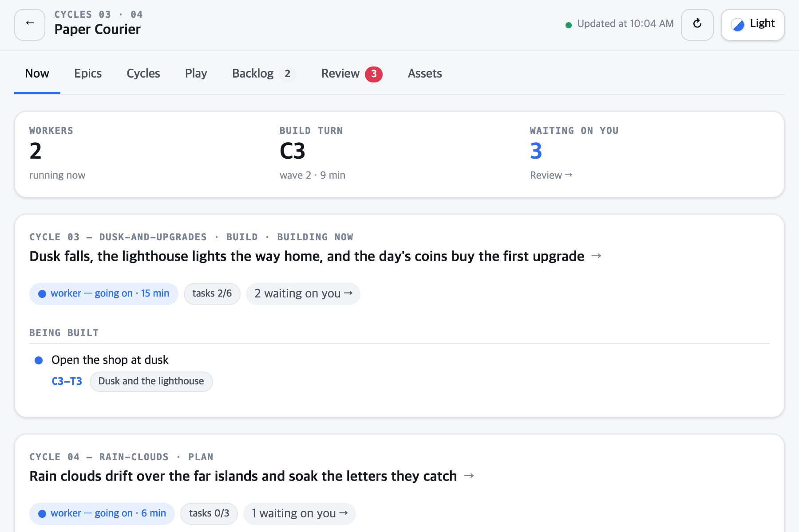
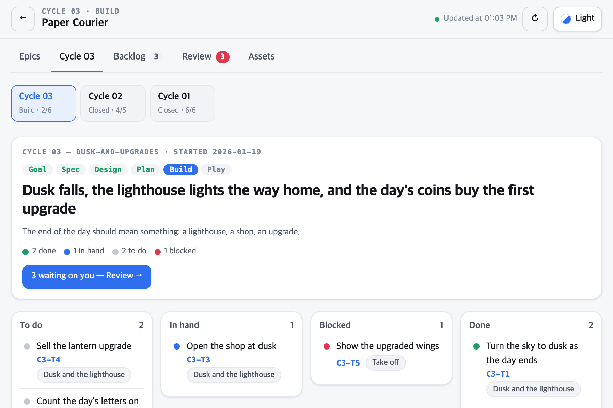
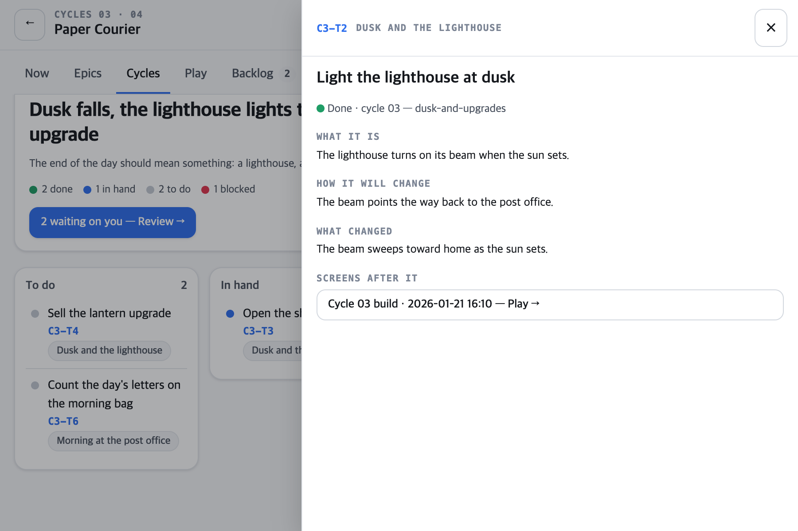
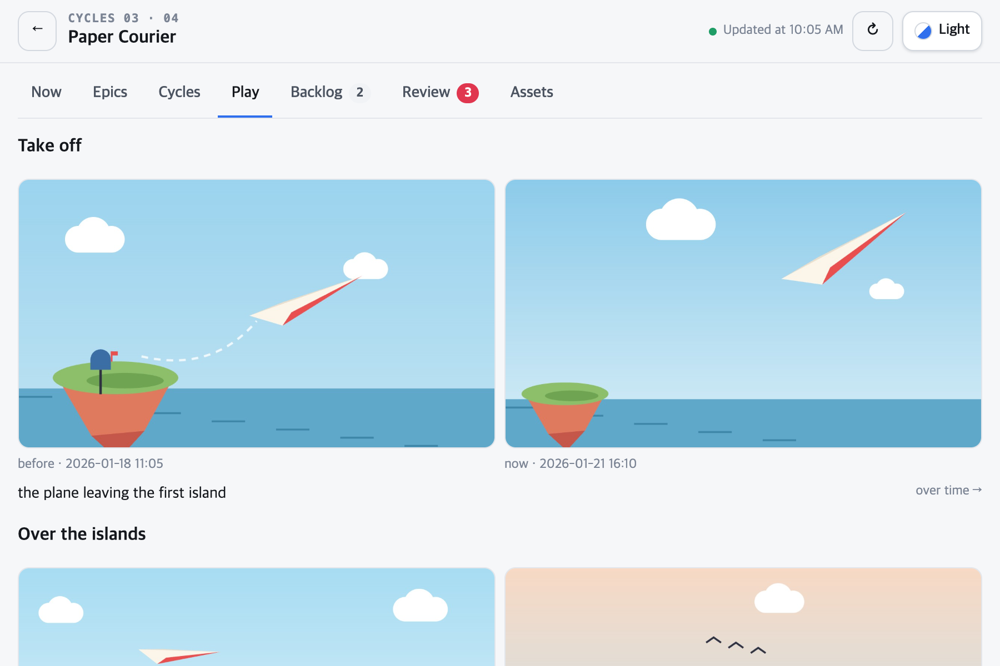
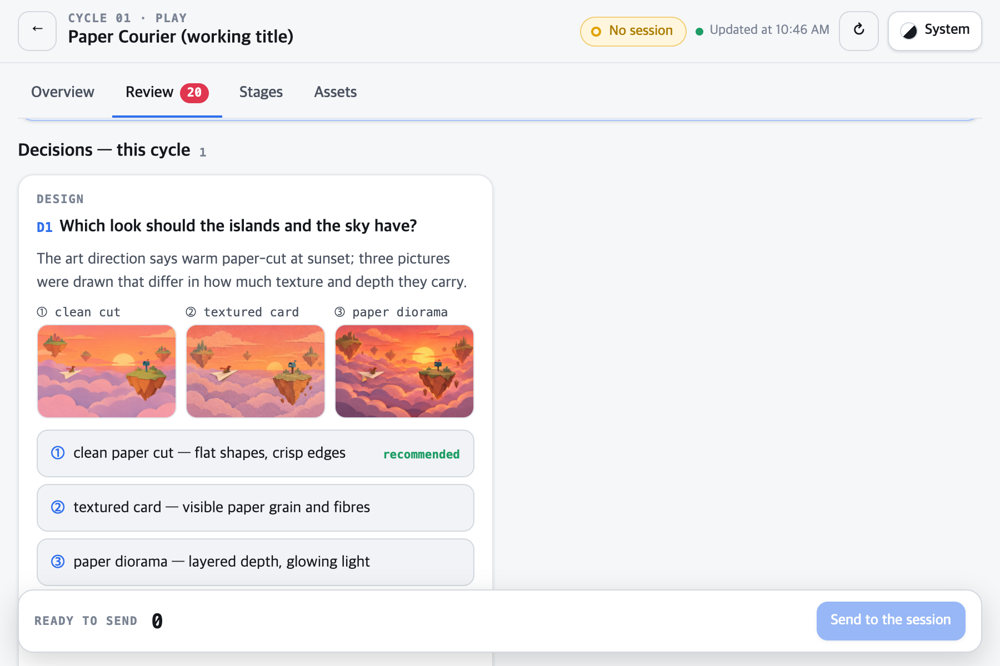

<p align="center">
  
</p>

**A [Claude Code](https://code.claude.com) plugin for making games.**
Agents make your game cycle by cycle — spec, design, build — and a CEO coordinates all of it, several cycles at once. You only decide, from a dashboard that shows where every game stands.

## Quick start

You need:

- [Claude Code](https://code.claude.com)
- [Python](https://www.python.org/downloads/) 3.9 or later
- [Node.js](https://nodejs.org) — for the dashboard
- The editor of the engine you make the game with (below) — a plain web game needs none

In your game's folder (an empty one is fine):

```bash
claude plugin marketplace add dudwns0921/claude-gamedev-kit
claude plugin install gamedev-kit@claude-gamedev-kit --scope project
```

Installed for the project, the kit stays with the game: anyone who opens the game's folder in Claude Code gets the same kit.
Then start Claude Code there and say what you want — there is nothing to learn:

```
I want to make a cozy farming game      → asks where it will be played, picks the engine, sets it up, writes the GDD with you, then hands the first goal to the CEO
this time, let's add a shop             → one cycle: spec, design, build; what is yours to decide waits on the dashboard
run it for me                           → the CEO coordinates the cycles, several at once; only what is yours to decide reaches you
I played it — the prices are unreadable → finds the causes and fixes them
```

Every step also has a slash command — `/gamedev-kit:init`, `start`, `ceo`, `cycle`, `playtest`, `board`, … — if you would rather type one.

### Engines games have been made with

- [Godot](https://godotengine.org/download)
- [Unity](https://unity.com/download)
- Web — plain HTML and JavaScript, no editor

## Why use it

Making a game with AI is easy. The trouble starts when making it takes weeks: you lose track of where it stands and what waits on you, the design and the code drift apart, and what you learned in the last game is gone by the next.

### You decide — the CEO coordinates the rest

<p align="center"></p>

One window is the CEO, and it coordinates all the work: it proposes the next goals, starts a worker — a headless Claude Code run — for each cycle that can move, and keeps the builds in order. Every question that comes up is put to you on the dashboard; your part is to decide. Where the engine allows it, each cycle builds in a folder of its own, so several build at once. The dashboard's Now tab shows what is in motion: the workers, the cycle each one holds, and whose turn it is to build. You can still work on a cycle by hand in a window of your own.

<p align="center"><picture><source media="(prefers-color-scheme: dark)" srcset="assets/dashboard-now-dark.png"></picture></p>

### See where every game stands — and decide there

<p align="center"><picture><source media="(prefers-color-scheme: dark)" srcset="assets/dashboard-dark.png"></picture></p>
<p align="center"><picture><source media="(prefers-color-scheme: dark)" srcset="assets/dashboard-cycle-dark.png"></picture></p>
<p align="center"><picture><source media="(prefers-color-scheme: dark)" srcset="assets/dashboard-task-dark.png"></picture></p>
<p align="center"><picture><source media="(prefers-color-scheme: dark)" srcset="assets/dashboard-play-dark.png"></picture></p>
<p align="center"><picture><source media="(prefers-color-scheme: dark)" srcset="assets/dashboard-decide-dark.png"></picture></p>
<p align="center"><picture><source media="(prefers-color-scheme: dark)" srcset="assets/dashboard-assets-dark.png"></picture></p>

A dashboard on your machine lays each game out like a tracker. Every part the player meets is an epic; each cycle is a board of its tasks; what you put off waits in a backlog. Open a task and it says what it is, how the game will change and what changed. Every question the agents have for you is a decision there, with the pictures (or a clip of play, or the sounds to choose between) to judge it by. Pick an answer and the game's Claude session picks it up; the top bar always says whether that session is listening. The Play tab shows the game's screens, shot along the same route at the end of every build, beside their earlier runs.

### The design and the code stay one thing

<p align="center"></p>

Every number and rule in the GDD has an ID, and the code that implements it carries the same ID. The kit finds what disagrees and what is not built, and aligns the side you name. The balance numbers are one Excel sheet that follows the code.

### Every game you make leaves the next one better

<p align="center"></p>

What tripped you becomes one of your rules, loaded into every game you make next. Once you say so, rules go to this repository as issues, and the ones that hold for anyone become the kit's rules for everybody.

## What it runs and sends

The scripts are plain Python (standard library only) and run on your machine. Hooks run them when a session starts, after edits and when a turn ends, to keep the status board, the balance table and the kit's rules in your game's CLAUDE.md up to date. Everything they write stays in your game's folder and in `~/.config/gamedev-kit/`. The play route's screens are kept in `docs/board/plays/`, out of git.

The CEO's workers are `claude -p` runs of your own Claude Code, with the permission mode you choose once per game (`acceptEdits` is recommended) and a spending cap each (`--max-budget-usd`, $15 by default) — they use your Claude account like any session.

What leaves your machine, and only then:

- **Your rules, as GitHub issues on this repository** — only after you say yes once (`/gamedev-kit:feedback`), or when you send them yourself. They go through your own [GitHub CLI](https://cli.github.com) login (`gh issue create` · `gh issue comment`). Each issue holds the rule's text, the engine, the kit's version and an eight-digit id salted on your machine; the game's name is not sent, and a rule that names your game or a date is held back. The open issues of this repository are read from `api.github.com` (no login) to find one the rule matches.
- **The dashboard** — when you start it, it is cloned from [gamedev-kit-board](https://github.com/dudwns0921/gamedev-kit-board) into `~/.config/gamedev-kit/board-app`, installed with `npm install`, built and run on `127.0.0.1`. It is not reachable from other machines.
- **Your own board service, if you set one up** — the board is sent to the HTTPS address and with the token you put in `~/.config/gamedev-kit/board.env`. Nothing is sent when that file has none.
- **A private claude.ai link, when you ask for one** — the board and the review page, published by Claude Code to your own account so you can open them on a phone.
- **A font** — the board's pages load the Pretendard font from `cdn.jsdelivr.net`.

The kit makes no assets and calls no AI or asset services of its own.

## License

MIT
