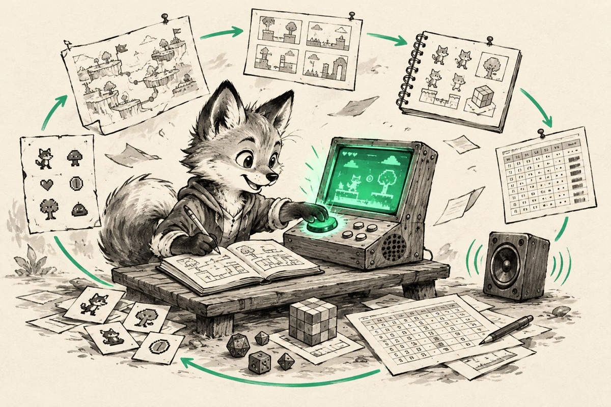

<p align="center">
  
</p>

**A repeatable way to make a game with [Claude Code](https://code.claude.com) — one that gets better with every game you make.**

You say what the next version should do. Agents write the spec, the design and the code, and stop to ask you whatever is yours to decide. You play it and say what is wrong. Then again. Works with **Godot** and **Unity** (Android).

One cycle, roughly:

```
you   /gamedev-kit:cycle add a shop between runs where the player spends coins

kit   Spec, design and plan are written. Three things are yours to decide:
        D1  Do unspent coins carry over to the next run?    ① yes   ② no    recommended: ②
        D2  Is the shop a separate screen or an overlay?    ① screen   ② overlay    recommended: ①
        D3  Make the shopkeeper sprite now, or use a placeholder?
      7 tasks in 3 waves, once you answer.

you   D1 ②. D2 overlay — I want to see the run behind it. D3 placeholder.

kit   Built. Your turn to play.

you   /gamedev-kit:playtest
      - prices are unreadable on a small screen
      - I can buy with zero coins

kit   Two causes found, two tasks written, both fixed. Play again.
```

## Quick start

In your game's folder (an empty one is fine):

```bash
claude plugin marketplace add dudwns0921/claude-gamedev-kit
claude plugin install gamedev-kit@claude-gamedev-kit --scope project
```

Then, inside Claude Code:

```
/gamedev-kit:init      pick an engine; the kit finds the editor, creates the project and installs its files
/gamedev-kit:start     write the GDD together, agree on the look, set the first goal
/gamedev-kit:cycle     build that goal — and every goal after it
```

You need Claude Code, Python 3.9 or later, and the engine's editor. Everything else is optional and listed under [Optional services](#optional-services).

## Why use it

- **One workflow, every time.** The same stages, the same documents and the same answer to "who decides this" — in every cycle and every game. Sessions end and models change; the workflow stays, so the tenth cycle runs like the first and you always know where the game stands.
- **It gets better at your games.** Two things pile up as you work. Your **voice**: how you decide when a choice could go either way. And **lessons**: the engine traps you hit and the ways you found to verify things, sent back to the kit and returned as rules. The next game starts with all of it.

<p align="center">
  
</p>

- **You stay the designer.** Rules, numbers and looks are asked, not assumed. What the agents write is a proposal until you answer.
- **Nothing is locked in.** The GDD, the cycle documents and the code are plain files in your repository. You ship where you choose.

It is built for a game you make over weeks. If you want a small game out of one prompt in a few minutes, a prompt-to-game platform will get you there faster.

## How you use it

### 1. Start a game — once

`/gamedev-kit:init` asks which engine, finds the editor on your machine (and tells you what to install if a build module is missing), creates the engine project if there is none, and installs the kit's files: `kit.config.json`, a GDD template, rules for your game's `CLAUDE.md`, and a balance value file.

`/gamedev-kit:start` then takes you to the first cycle. It interviews you one question at a time and writes down only what you confirmed, agrees on the look with references or concept images, and proposes a first goal: one lap of the innermost loop. You can stop at any point — where the game stands is read from its files, so any later session picks it up.

### 2. Run a cycle — again and again

```
/gamedev-kit:cycle add a shop between runs where the player spends coins
```

The kit writes one document in `docs/cycle/` and moves it through the stages in the banner above. After the plan it stops and asks you the open decisions, each with options and a recommendation. You answer (`D2: option 1`), and the build runs — tasks that touch different files run in parallel.

| You type | What happens |
|---|---|
| `/gamedev-kit:cycle <goal>` | New cycle: spec, design and plan, then your decisions |
| `/gamedev-kit:cycle next` | Next stage of the current cycle |
| `/gamedev-kit:cycle status` | Current stage, remaining tasks, unanswered decisions |
| `/gamedev-kit:cycle auto <goal>` | Runs up to the point of playing without asking — see [Auto mode](#auto-mode) |

### 3. Play it, say what is wrong

A cycle ends at **play** and stays there. Play the build, write down what you saw, and hand over the list:

```
/gamedev-kit:playtest
- the jump feels floaty near the apex
- coins sometimes spawn inside walls
- shop prices are unreadable on a small screen
```

An analyst agent reads the code and the GDD, finds the causes and writes a task document in `docs/playtest/`; a developer agent builds each task. Repeat until it is good, then state the next goal — that closes the cycle.

### 4. Ship it — when you decide

```
/gamedev-kit:deploy
```

Shipping is not a stage of the cycle. Call it after as many cycles as you like. The kit builds, shows you the target, version and size, and uploads only when you approve.

## Commands

**Set up**

| Command | What it does |
|---|---|
| `/gamedev-kit:init` | Sets up a game repo, from an empty folder if need be. `init rules` realigns the kit's rule block in your `CLAUDE.md` after the kit updates |
| `/gamedev-kit:start` | GDD → concept → first goal → hands over to `cycle`. Stages can be skipped |

**Make**

| Command | What it does |
|---|---|
| `/gamedev-kit:cycle` | One cycle through a single document. Decisions that are chosen by eye are asked with a picture: the question, the options and a crop for each on one sheet |
| `/gamedev-kit:playtest` | Problem list → analysis document → one agent per task. `plan` analyses only, `implement [T3 …]` builds only, `status` lists what remains |
| `/gamedev-kit:handoff` | Leaves the work in progress as a short note in `docs/handoff/`; `handoff resume` continues from it in a new session |

**Keep in sync, see where you are**

| Command | What it does |
|---|---|
| `/gamedev-kit:gdd-sync` | Compares the GDD's sync table with `GDD: <ID>` markers in code. Reports by default; `to-code` or `to-gdd` aligns one side to the other |
| `/gamedev-kit:balance-table` | Edit balance numbers in an Excel table and keep it aligned with the value file in code (export · bake · check · serve) |
| `/gamedev-kit:board` | A status board as HTML pages: one card per stage of play, showing how far function, art, sound and verification have come. Once drawn, a hook redraws it whenever the documents change — no model involved |

**Assets and footage**

| Command | What it does |
|---|---|
| `/gamedev-kit:asset` | Makes 3D models, 2D sprites and sounds from a description. You approve the picture before it becomes a mesh or an animated sheet. One art style paragraph is attached to every asset, and what you say when rejecting one is kept for the next |
| `/gamedev-kit:video` | Footage that looks filmed: description → you approve → generated → you watch → placed. Trailers and devlog clips as mp4, in-game cutscenes in the format the engine reads |

**Ship and give back**

| Command | What it does |
|---|---|
| `/gamedev-kit:deploy` | Build and upload to itch.io with butler (`prepare` · `push` · `status`), then draft the itch.io devlog for that build (`devlog`). You paste the devlog yourself |
| `/gamedev-kit:feedback` | Sends what this game taught you that other games will also hit (`docs/kit-feedback.md`) to this repository as issues. Shows the exact text and sends only the lines you approve |
| `/gamedev-kit:voice` | Shows what the kit has learned about how you decide, and lets you correct it — see [Voice](#voice) |

## Agents

The model is fixed per agent, so analysis and design run on the strongest model and writing code to a finished plan runs on a cheaper one, whatever model your session uses. The session only conducts.

| Agent | Model | What it does |
|---|---|---|
| `systems-designer` | Fable | Turns a goal into rules, balance numbers and the dimensions of spaces. Offers ranges with the calculation attached; does not fix values |
| `designer` | Fable (Opus for screenshot checks) | Writes how the spec looks and sounds: UI, effects, sound, the asset list. Checks screenshots against `docs/DESIGN.md` |
| `developer` | Opus to plan, Sonnet to build | Splits a cycle into tasks, then implements one task exactly as written. Does not re-analyse |
| `playtest-analyst` | Fable | Finds the causes behind a problem list and writes them as a task document. Does not change code |
| `deployer` | Sonnet | Check, build, butler push. On a broken build, finds the first error and returns it |
| `devlog-writer` | Sonnet | Drafts the itch.io devlog for a deployed build from what was actually made. Does not post it |

## How a cycle works

<p align="center"></p>

The frame comes from [gstack](https://github.com/garrytan/gstack) — an agent per role, a document per stage, each stage reading the one before — fitted to one version of a game.

```
goal ─▶ spec ───────────▶ design ─▶ plan ───▶ build ───▶ play ◀─┐
you     systems-designer  designer  developer developer  you ───┘ fix what you found (playtest)
                                       ▲
                               decisions are asked
                        (auto: your voice decides ─▶ stops here)
```

**There is no closing stage.** A cycle rests at play: play, say, fix, as many times as it takes. Stating the next goal closes the previous cycle and shows once what it left undone. Lessons are written down where you tripped, not collected at the end.

**No agent decides for you.** Agents return "things to decide" as options with one recommendation, and your answer goes into the cycle document's decisions section verbatim. Work that hangs on an unanswered decision is not done.

### Voice

From those answers the kit builds your **voice**: the side you keep choosing when a decision could go either way (principles), where you keep departing from the recommendation (biases), and what is not yet known.

You do nothing for it. Before a decision is asked, the kit predicts your answer; when you answer, it scores the prediction and folds the answer in. Neither the prediction nor the hit rate is shown, because a visible prediction pulls the answer toward it. You see the voice twice: when a new cycle starts (only the lines added since) and when you call `/gamedev-kit:voice` — that is where you correct it.

The voice belongs to you, not to a game. It lives outside the game repos in `~/.config/gamedev-kit/voice/` (override with `GAMEDEV_KIT_VOICE`), as a clone of one private repository of yours, and grows across games and engines. `/gamedev-kit:init` asks for that repository's address once per machine and stops if the repository is readable without login. A principle needs two decisions behind it to stand.

### Auto mode

`/gamedev-kit:cycle auto <goal>` runs from the goal to the end of the build without asking. Your voice decides — by a matching principle if there is one, otherwise by the agent's recommendation.

- Decisions made for you are marked `[~]` in the cycle document with their basis, and stay unconfirmed until you accept or overturn them. Overturning one redoes the work that hung on it.
- Some decisions stay yours: anything that costs money or credits (asset generation), anything that leaves your machine, and anything that discards what you made. They are left open and only the work that hangs on them waits. Missing assets get placeholders.
- It stops before play. It does not ship and does not start the next cycle — nothing is stacked on a version nobody has played.
- A decision made for you is not evidence for your voice until you accept it, and counts for less than one you made yourself.
- It is on for that one run. Continuing with `next` asks again.

## It compounds

The kit does not teach how to implement — Claude Code already does that. What it holds is what a model has no way of knowing: the traps of a given engine, how to verify without a screen, the order of work and who decides what. That grows with every game, along two paths: your [voice](#voice), and lessons.

A lesson is one line that would have saved an afternoon. These are in the Godot rules today, each put there by a game that hit it:

> **Run every headless test under a time limit.** A script with a parse error does not fail the run — it hangs. When a run hangs, look for a parse error first.

> **Do not write comments in `project.godot`.** When the editor or an import rewrites the file, a `#` line becomes a broken key and the setting line right below it disappears.

> **Web builds render at 1x.** Rendering at 2x pixels on a Retina screen gives 4–5 fps.

A line in your voice is the same kind of thing about you rather than the engine — for example, *"when a number can be tuned in the table later, don't hold the build for it"* — and it stands only once two of your decisions back it.

<details>
<summary>How a lesson travels from one game to all of them</summary>

```
you trip in a game ─▶ the lesson is sorted on the spot
                        ├─ this game only ───────────▶ that game's CLAUDE.md
                        └─ other games will hit it ──▶ docs/kit-feedback.md (one line each)
                                                          │  /gamedev-kit:feedback — only lines you approve
                                                          ▼
                                       issues in this repository — lines from any game meet here
                                                          │
                                                          ▼
                             engines/<engine>/CLAUDE.md · skill documents · scripts
                                                          │  /gamedev-kit:init rules
                                                          ▼
                    the kit's rule block in every game's CLAUDE.md — a new game starts with it
```

</details>

- **Anyone using the kit can send lessons.** When unsent lines pile up, a hook says so at session start. Nothing goes out by itself: issues are public, so you see the text first.
- **One test sorts them**: would you need to know this when making a different game? Only what still makes sense without the game's name, files and numbers is sent.
- **A tool beats a rule.** What a script can prevent is prevented by the script instead of being written down.
- **Your game receives one block.** In your `CLAUDE.md`, only the marked block belongs to the kit. When the kit updates, a hook replaces that block at session start and leaves everything you wrote untouched; if you edited inside the block, it only tells you.

## Tokens and time

Measured on real session logs, most tokens go to **what the main session re-reads every turn**. So the ledgers of cycle and playtest documents are kept by scripts rather than by reading whole documents, a hook suggests a new session once context passes 200k tokens, and the cycle document or a `/gamedev-kit:handoff` note carries the context across. Compare before and after with `python3 tools/session_usage.py <game repo>`.

## Engines

Pick the engine in `/gamedev-kit:init`. The kit finds the editor, creates the project and from then on drives the editor from the command line to import, check for script errors and build.

| | Godot 4 | Unity |
|---|---|---|
| What `deploy` builds | A Web export, uploaded to itch.io | An Android App Bundle for Google Play. You upload it in the Play Console |
| What `init` looks for | The `godot` executable (or `GODOT`) | An editor installed through Unity Hub (or `UNITY`) with Android Build Support, the Android SDK and NDK, and OpenJDK |
| Balance table while the game runs | The game reads the table file directly, so an edit shows up without a restart | The game runs on baked values; bake, then run again |
| Asset formats | glb · png · mp3 | fbx · png · mp3 |
| Cutscene formats | mp4 · ogv | mp4 |

`gdd-sync`, `balance-table`, `cycle`, `playtest`, `board`, `asset` and `video` work the same on both. Each engine also brings its own rules into your game's `CLAUDE.md` — how to verify without opening the editor, and the traps found while making games with it.

Everything engine-specific lives in one folder, `engines/<engine>/`. The skills and scripts read only values from `kit.config.json` (extensions, patterns, paths, build commands), so supporting another engine means adding a folder.

## Optional services

Nothing here is needed for the cycle itself. Keys stay outside the repository, in `~/.config/gamedev-kit/asset.env`; the skill walks you through it the first time.

| For | You need |
|---|---|
| Concept images, 3D models | `OPENAI_API_KEY`, `MESHY_API_KEY`, and Blender to fix size and origin |
| 2D sprites | `LUDO_API_KEY` ([Ludo](https://ludo.ai)) |
| Sound and music | `ELEVENLABS_API_KEY` |
| Footage | `HF_API_KEY_ID` and `HF_API_KEY_SECRET` ([Higgsfield](https://docs.higgsfield.ai/docs)), and ffmpeg |
| itch.io | [butler](https://itch.io/docs/butler/), logged in once by you |

## Updating

```bash
claude plugin marketplace update claude-gamedev-kit
claude plugin update gamedev-kit@claude-gamedev-kit
```

## Repository layout

```
.claude-plugin/     plugin.json · marketplace.json (this repository is both the plugin and its marketplace)
skills/<name>/      one skill per folder, its scripts in scripts/
agents/<name>.md    agents — only work that needs a fixed model is an agent
engines/<engine>/   kit.config.json (engine settings) · NOTES.md (what to do after installing) · CLAUDE.md (engine rules:
                    how to verify, and traps) · files/ (templates copied into the game) · project.json (how to recognise
                    the project, find the editor and create one) · gitignore (lines added to the game's .gitignore)
templates/          GDD.md · DESIGN.md · CLAUDE.md — templates installed into the game repo
hooks/              suggest a new session when context grows · keep the kit's rule block current ·
                    say when unsent lessons pile up · redraw the board when documents change
tools/              session_usage.py — where tokens went, from a game repo's session logs ·
                    kit_feedback.py — collect lessons from game folders on this machine
tests/              test_tools.py — runs the tools end to end without an engine, against fake servers; nothing leaves the machine ·
                    test_structure.py — checks the structure rules by reading files only
```

The tools live in the plugin and the game lives elsewhere. Scripts walk up from the current folder to find `kit.config.json` and treat that folder as the game's root.

## License

[MIT](LICENSE)
