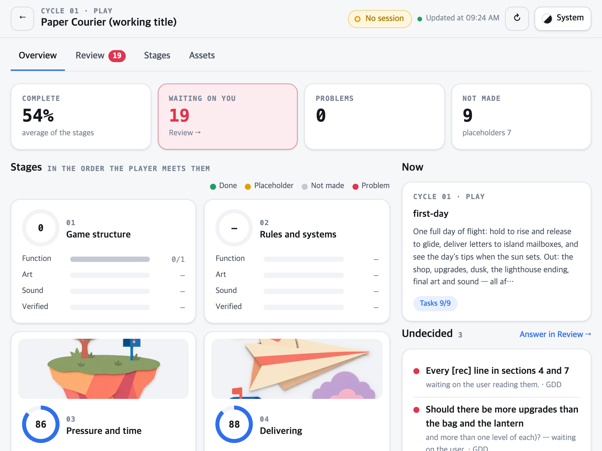
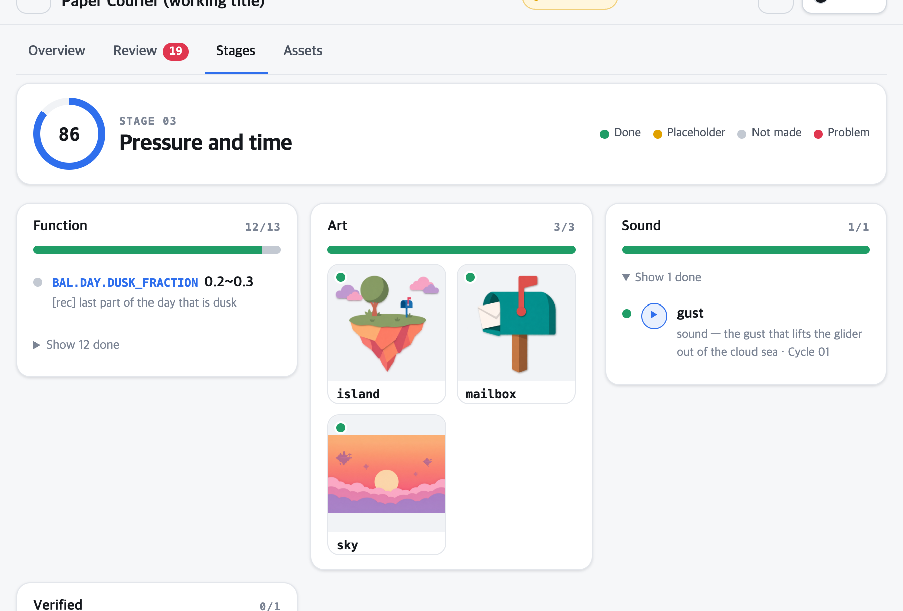
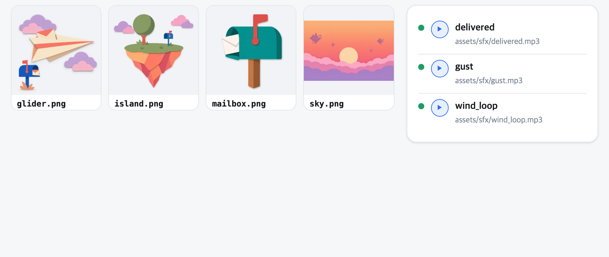

<p align="center">
  
</p>

**A [Claude Code](https://code.claude.com) plugin for making games.**
Agents make your game one cycle at a time — spec, design, build. You decide, from a dashboard that shows where every game stands.

## Quick start

You need:

- [Claude Code](https://code.claude.com)
- [Python](https://www.python.org/downloads/) 3.9 or later
- [Node.js](https://nodejs.org) — for the dashboard
- The editor of the engine you make the game with (below) — a plain web game needs none

In your game's folder (an empty one is fine):

```bash
claude plugin marketplace add dudwns0921/claude-gamedev-kit
claude plugin install gamedev-kit@claude-gamedev-kit --scope project
```

Installed for the project, the kit stays with the game: anyone who opens the game's folder in Claude Code gets the same kit.
Then start Claude Code there and say what you want — there is nothing to learn:

```
I want to make a cozy farming game      → asks where it will be played, picks the engine, sets it up, then writes the GDD with you
this time, let's add a shop             → one cycle: spec, design, build; what is yours to decide waits on the dashboard
I played it — the prices are unreadable → finds the causes and fixes them
```

Every step also has a slash command — `/gamedev-kit:init`, `start`, `cycle`, `playtest`, `board`, … — if you would rather type one.

### Engines games have been made with

- [Godot](https://godotengine.org/download)
- [Unity](https://unity.com/download)
- Web — plain HTML and JavaScript, no editor

## Why use it

Making a game with AI is easy. The trouble starts when making it takes weeks: you lose track of where it stands and what waits on you, the design and the code drift apart, and what you learned in the last game is gone by the next.

### See where every game stands — and decide there

<p align="center"><picture><source media="(prefers-color-scheme: dark)" srcset="assets/dashboard-dark.png"></picture></p>
<p align="center"><picture><source media="(prefers-color-scheme: dark)" srcset="assets/dashboard-stage-dark.png"></picture> <picture><source media="(prefers-color-scheme: dark)" srcset="assets/dashboard-assets-dark.png"></picture></p>

A dashboard on your machine shows each game as the player meets it, stage by stage — what is done, a placeholder, not made, or a problem. Every question the agents have for you is a decision there, with the pictures (or a clip of play, or the sounds to choose between) to judge it by. Pick an answer and the game's Claude session picks it up; the top bar always says whether that session is listening.

### The design and the code stay one thing

<p align="center"></p>

Every number and rule in the GDD has an ID, and the code that implements it carries the same ID. The kit finds what disagrees and what is not built, and aligns the side you name. The balance numbers are one Excel sheet that follows the code.

### Every game you make leaves the next one better

<p align="center"></p>

What tripped you becomes one of your rules, loaded into every game you make next. Once you say so, rules go to this repository as issues, and the ones that hold for anyone become the kit's rules for everybody.

## License

MIT
