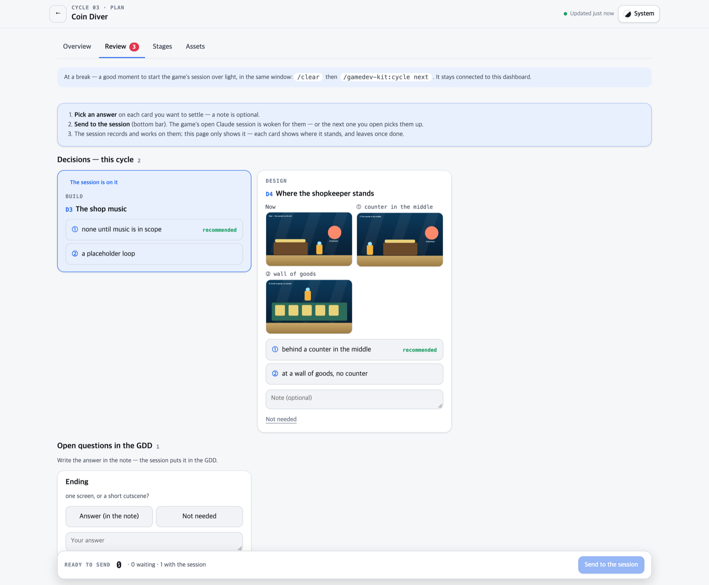

<p align="center">
  
</p>

**A repeatable way to make a game with [Claude Code](https://code.claude.com) — one that gets better with every game you make.** · [gamedev-kit-site.vercel.app](https://gamedev-kit-site.vercel.app) ([한국어](https://gamedev-kit-site.vercel.app/ko))

You say what the next version should do. Agents write the spec, the design and the code, and stop to ask you whatever is yours to decide. You play it and say what is wrong. Then again. Works with **Godot**, **Unity** (Android) and plain **web** games.

One cycle, roughly:

```
you   /gamedev-kit:cycle add a shop between runs where the player spends coins

kit   Spec, design and plan are written. Three things are yours to decide:
        D1  Do unspent coins carry over to the next run?    ① yes   ② no    recommended: ②
        D2  Is the shop a separate screen or an overlay?    ① screen   ② overlay    recommended: ①
        D3  Make the shopkeeper sprite now, or use a placeholder?
      7 tasks in 3 waves, once you answer.

you   D1 ②. D2 overlay — I want to see the run behind it. D3 placeholder.
      (or pick them on the dashboard, from your phone)

kit   Built. Your turn to play.

you   /gamedev-kit:playtest
      - prices are unreadable on a small screen
      - I can buy with zero coins

kit   Two causes found, two tasks written, both fixed. Play again.
```

## Quick start

In your game's folder (an empty one is fine):

```bash
claude plugin marketplace add dudwns0921/claude-gamedev-kit
claude plugin install gamedev-kit@claude-gamedev-kit --scope project
```

Then, inside Claude Code:

```
/gamedev-kit:init      pick an engine; the kit finds the editor, creates the project and installs its files (and offers the dashboard)
/gamedev-kit:start     write the GDD together, agree on the look, set the first goal
/gamedev-kit:cycle     build that goal — and every goal after it
```

You need Claude Code and Python 3.9 or later — and, for Godot or Unity, that engine's editor. Assets and their services are optional — see [Assets](#assets).

## Why use it

Claude Code can already write the game. What goes wrong over weeks is everything around the writing: the design document and the code drift apart, nobody can say how finished the game is, and what you learned in the last game is gone by the next. The kit is one workflow, the same in every cycle and every game, built around three things.

### 1. The design and the code stay one thing

<p align="center">
  
</p>

Every number and rule in the GDD has an ID, and the code that implements it carries a `GDD: <ID>` marker. `/gamedev-kit:gdd-sync` compares the two and reports what is synced, what disagrees and what is not built — then aligns whichever side you name. Balance numbers go one step further: `/gamedev-kit:balance-table` keeps them on one Excel sheet that follows the code, and a number you change there is baked back into the code.

### 2. You see where the game stands — and answer from there

<p align="center"><picture><source media="(prefers-color-scheme: dark)" srcset="assets/dashboard-dark.png"></picture></p>

The dashboard runs on your own machine and shows every game you make with the kit: one card per stage of play, as the player meets it — what is done, what is a placeholder, what is not made, what is a problem — and what is still undecided.
It is drawn from the GDD, the cycle and playtest documents and the asset records; no model reads them, and a hook sends a fresh board whenever they change. `/gamedev-kit:init` offers it at the end (it needs Node.js); without it, the same board is a set of pages in `docs/board/`.

<p align="center"><picture><source media="(prefers-color-scheme: dark)" srcset="assets/review-dark.png"></picture></p>

Everything that waits on you is on its Review tab: every question the session has for you is a decision, with the pictures to look at — a capture of now, the candidates — and a button per option; asset images to approve; checks by playing.
**Send to the session** and the game's open Claude session is woken for your answers — on the desktop, in a terminal, or on your phone through Tailscale. The dashboard never acts on the game itself: it only signals, and the card shows where your answer stands until the session is done with it.
When the session's conversation has grown long and the cycle is at a break, it says so: type `/clear`, then `/gamedev-kit:cycle next`, and the session starts over light in the same window, still connected.

### 3. It gets better at your games

<p align="center">
  
</p>

Your **rules** pile up as you work, on your machine: the traps you hit and the ways you found to verify things. They are loaded into every game you make with the kit, so the next one starts with all of them. Once you say so, they also go on to the kit as issues, where the ones that hold for anyone become rules for everybody.

You stay the designer throughout — rules, numbers and looks are asked, not assumed — and nothing is locked in: the GDD, the cycle documents and the code are plain files in your repository.

It is built for a game you make over weeks. If you want a small game out of one prompt in a few minutes, a prompt-to-game platform will get you there faster.

## How you use it

### 1. Start a game — once

`/gamedev-kit:init` asks which engine, finds the editor on your machine (and tells you what to install if a build module is missing), creates the engine project if there is none, and installs the kit's files: `kit.config.json`, a GDD template, rules for your game's `CLAUDE.md`, and a balance value file.

`/gamedev-kit:start` then takes you to the first cycle. It interviews you one question at a time and writes down only what you confirmed, agrees on the look with references or concept images, and proposes a first goal: one lap of the innermost loop. You can stop at any point — where the game stands is read from its files, so any later session picks it up.

### 2. Run a cycle — again and again

```
/gamedev-kit:cycle add a shop between runs where the player spends coins
```

The kit writes one document in `docs/cycle/` and moves it through the stages in the banner above. After the plan it stops and asks you the open decisions, each with options and a recommendation — a decision chosen by eye comes as a picture. You answer (`D2: option 1`), and the build runs; tasks that touch different files run in parallel.

| You type | What happens |
|---|---|
| `/gamedev-kit:cycle <goal>` | New cycle: spec, design and plan, then your decisions |
| `/gamedev-kit:cycle next` | Next stage of the current cycle |
| `/gamedev-kit:cycle status` | Current stage, remaining tasks, unanswered decisions |

### 3. Play it, say what is wrong

A cycle ends at **play** and stays there. Play the build, write down what you saw, and hand over the list:

```
/gamedev-kit:playtest
- the jump feels floaty near the apex
- coins sometimes spawn inside walls
- shop prices are unreadable on a small screen
```

An analyst agent reads the code and the GDD, finds the causes and writes a task document in `docs/playtest/`; a developer agent builds each task. Repeat until it is good, then state the next goal — that closes the cycle.

### 4. Ship it — when you decide

```
/gamedev-kit:deploy
```

Shipping is not a stage of the cycle. Call it after as many cycles as you like. The kit builds, shows you the platform, target, version and size, and uploads only when you approve. Where the build goes is a setting: itch.io is uploaded with [butler](https://itch.io/docs/butler/), which you log in to once; for Google Play the kit builds and tells you which file to upload in the Play Console.

## Commands

**Set up**

| Command | What it does |
|---|---|
| `/gamedev-kit:init` | Sets up a game repo, from an empty folder if need be. `init rules` realigns the kit's rule block in your `CLAUDE.md` after the kit updates |
| `/gamedev-kit:start` | GDD → concept → first goal → hands over to `cycle`. Stages can be skipped |

**Make**

| Command | What it does |
|---|---|
| `/gamedev-kit:cycle` | One cycle through a single document: `<goal>` · `next` · `status`. `next` is also how a cleared session (`/clear`) picks up where it stopped |
| `/gamedev-kit:playtest` | Problem list → analysis document → one agent per task. `plan` analyses only, `implement [T3 …]` builds only, `status` lists what remains |

**Keep in sync, see where you are**

| Command | What it does |
|---|---|
| `/gamedev-kit:gdd-sync` | Compares the GDD's sync table with `GDD: <ID>` markers in code. Reports by default; `to-code` or `to-gdd` aligns one side to the other |
| `/gamedev-kit:balance-table` | Keeps the game's balance numbers on one Excel sheet that follows the value file in code and opens from the status board (export · bake · check) |
| `/gamedev-kit:board` | Draws the status board and the review page as HTML pages, keeps them current, carries them to a private link for a phone, and runs a local dashboard of every game (`serve`) |

**Assets and footage**

| Command | What it does |
|---|---|
| `/gamedev-kit:asset` | Optional. Makes 3D models, 2D sprites and sounds from a description — with a tool you connected over MCP or the kit's own scripts — or tells you where to put a file you made yourself. You approve the picture before it becomes a mesh or an animated sheet. One art style paragraph is attached to every asset, and what you say when rejecting one is kept for the next |
| `/gamedev-kit:video` | Footage that looks filmed: description → you approve → generated → you watch → placed. Trailers and clips for the game's page as mp4, in-game cutscenes in the format the engine reads |

**Ship and give back**

| Command | What it does |
|---|---|
| `/gamedev-kit:deploy` | Check, build, show what goes where, and upload on your approval (`prepare` · `push` · `status`). The platform — itch.io or Google Play — is a setting in `kit.config.json` |
| `/gamedev-kit:feedback` | Your own rules — shows them, and sends them to this repository as issues — see [Your rules](#your-rules) |

## How it works

<p align="center"></p>

The frame comes from [gstack](https://github.com/garrytan/gstack) — an agent per role, a document per stage, each stage reading the one before — fitted to one version of a game.

**There is no closing stage.** A cycle rests at play: play, say, fix, as many times as it takes. Stating the next goal closes the previous cycle and shows once what it left undone.

**No agent decides for you.** Agents return "things to decide" as options with one recommendation, and your answer goes into the cycle document verbatim. Work that hangs on an unanswered decision is not done.

**The model is fixed per agent**, whatever model your session uses: thinking — the spec, the design, finding causes — runs on Opus, and writing code to a finished plan runs on Sonnet. The session only conducts. To put the thinking on Fable instead, set `"models": "max"` in the game's `kit.config.json`.

| Agent | Model | What it does |
|---|---|---|
| `systems-designer` | Opus | Turns a goal into rules, balance numbers and the dimensions of spaces. Offers ranges with the calculation attached; does not fix values |
| `designer` | Opus | Writes how the spec looks and sounds: UI, effects, sound, the asset list. Checks screenshots against `docs/DESIGN.md` |
| `developer` | Opus to plan, Sonnet to build | Splits a cycle into tasks, then implements one task exactly as written. Does not re-analyse |
| `playtest-analyst` | Opus | Finds the causes behind a problem list and writes them as a task document. Does not change code |
| `deployer` | Sonnet | Check, build, upload to the configured platform. On a broken build, finds the first error and returns it |

**Sessions stay short.** Most tokens go to what the main session re-reads every turn, so the ledgers of cycle and playtest documents are kept by scripts, a hook suggests `/clear` once context passes 200k tokens, and the cycle document carries the work across — what a session has in hand outside the tasks is left in it as a few lines.

## Your rules


A rule is one line that would have saved an afternoon. Where a game trips — a task is blocked, a playtest fix lands — the lesson is sorted on the spot:

| The lesson holds for | It goes to | When it applies |
|---|---|---|
| this game only | that game's `CLAUDE.md` | at once |
| your next game too | **your own rules**, in `~/.config/gamedev-kit/rules/` | from the next session, in every game you make — no approval |

These are in the kit's Godot rules today, each put there by a game that hit it:

> **Run every headless test under a time limit.** A script with a parse error does not fail the run — it hangs. When a run hangs, look for a parse error first.

> **Do not write comments in `project.godot`.** When the editor or an import rewrites the file, a `#` line becomes a broken key and the setting line right below it disappears.

> **Web builds render at 1x.** Rendering at 2x pixels on a Retina screen gives 4–5 fps.

Whether a rule holds for anyone's game is not for you to judge line by line — the kit sorts that when it reads rules from many games together. You are asked once whether your rules may go to the kit as public issues; from then on each new one goes by itself, except anything that names a game or a date, which is held back for you to reword. Say no, and they go only when you send them (`/gamedev-kit:feedback`, or the dashboard's Rules page). When enough issues have collected, an action drafts a single pull request that turns them into rules, and a maintainer reviews it. When the kit takes one of your rules in, you are asked whether to drop your copy — it is read on every turn, so dropping it saves tokens.

In your game's `CLAUDE.md`, only one marked block belongs to the kit. When the kit updates, a hook replaces that block at session start and leaves everything you wrote untouched; if you edited inside the block, it only tells you.

### Where they live

`~/.config/gamedev-kit/rules/` on your machine — `rules.md` for any engine, `rules-<engine>.md` for one. The first session in a game asks whether its `CLAUDE.md` may load files from outside the project — those are your rules; approve it once per game.

## Engines

Godot 4, Unity, and the web — plain HTML and JavaScript, with no editor at all. `/gamedev-kit:init` finds the editor on your machine, where there is one, and tells you what is missing.
Each engine's build is for a platform, set in `kit.config.json`: with Godot and the web, `deploy` makes a web build and uploads it to itch.io; with Unity it builds an Android App Bundle and tells you to upload it in the Play Console.

Each engine also brings its own rules into your game's `CLAUDE.md`: how to verify without opening the editor, and the traps found while making games with it.

## Assets

Assets are not needed for a cycle. A cycle lists what it needs — what, where it goes, what size — and runs on placeholders. A file you put in that place counts, whoever made it, and there are three ways to make one:

1. **Bring your own.** `/gamedev-kit:asset` tells you the path, the format and the size.
2. **A tool you connected to Claude Code over MCP.** The asset skill uses it and keeps its own steps: the art style is attached, you approve the picture before the costly step, the file lands in its place.
3. **The kit's own scripts**, with keys you keep outside the repository in `~/.config/gamedev-kit/asset.env`:

| For | You need |
|---|---|
| Concept images, 3D models | `OPENAI_API_KEY`, `MESHY_API_KEY`, and Blender to fix size and origin |
| 2D sprites | `LUDO_API_KEY` ([Ludo](https://ludo.ai)) |
| Sound and music | `ELEVENLABS_API_KEY` |
| Footage | `HF_API_KEY_ID` and `HF_API_KEY_SECRET` ([Higgsfield](https://docs.higgsfield.ai/docs)), and ffmpeg |

Several of these services publish their own MCP server — [Meshy](https://github.com/meshy-dev/meshy-mcp-server), [Ludo](https://github.com/Ludo-AI/ludo-mcp) and [Higgsfield](https://higgsfield.ai/mcp) do. With one connected, keeping up with that service's API is no longer the kit's job. What each server covers and what it charges for is the service's to say.

## Updating

```bash
claude plugin marketplace update claude-gamedev-kit
claude plugin update gamedev-kit@claude-gamedev-kit
```

Run both, in that order, in the game's folder: the first fetches the list of versions, and the plugin is installed per project, so each game is updated on its own. `claude plugin list` shows the version a folder is using.

## Repository layout

```
.github/            harvest.yml · harvest.md — the action that drafts one pull request from the collected feedback issues
.claude-plugin/     plugin.json · marketplace.json (this repository is both the plugin and its marketplace)
skills/<name>/      one skill per folder, its scripts in scripts/
agents/<name>.md    agents — only work that needs a fixed model is an agent
engines/<engine>/   kit.config.json (engine settings) · NOTES.md (what to do after installing) · CLAUDE.md (engine rules:
                    how to verify, and traps) · files/ (templates copied into the game) · project.json (how to recognise
                    the project, find the editor and create one) · gitignore (lines added to the game's .gitignore)
platforms/<name>/   platform.json (the upload tool, how to tell it is logged in, the upload command or what to tell you
                    when there is none, the form of a target) · NOTES.md (what you do once: log in, create the page)
templates/          GDD.md · DESIGN.md · CLAUDE.md — templates installed into the game repo
hooks/              suggest /clear when context grows · keep the kit's rule block current ·
                    send your rules to the kit as you said · keep the balance table and the board current as documents change
tools/              session_usage.py — where tokens went, from a game repo's session logs ·
                    harvest.py — which issues a harvest reads, and the check on what it changed
tests/              test_tools.py — runs the tools end to end without an engine, against fake servers; nothing leaves the machine ·
                    test_structure.py — checks the structure rules by reading files only
```

## License

[MIT](LICENSE)
